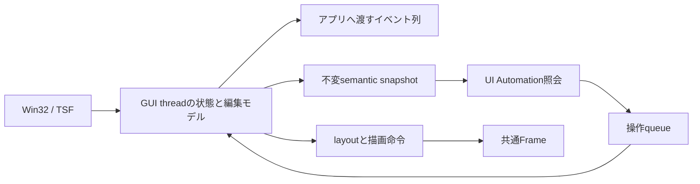

# Windows GUI内部仕様 v1

状態: 実装前の設計。本書で選択する方式・API・上限は現行機能ではない。
[描画・Windowの設計](gui-rendering.md)、[資源ABI](resource-abi.md)、[compiler連携](compiler-integration.md) に接続する。
Windows 10 1809以降/Windows 11 x64を先行し、ゲームと共存できる保持型のGUIを定める。
各操作のC symbol・操作ID・全ライブラリの型は [個別C ABI](native-operations.md)、[公開API](public-apis.md) と登録表に定める。

## 初期版で選ぶもの

| 項目 | 採用する仕様 |
|---|---|
| 部品 | Panel、Row、Column、Label、Button、単一行TextInput |
| 構造 | GuiContextが所有するwidget tree。Window一つに有効なGuiContextは一つ |
| 描画 | 既存Frameへ命令を追加。widgetごとの子HWNDやネイティブButton/Editを必須にしない |
| 配置 | DIP単位のAuto/Px/Fillと余白・整列。百分率、CSS、循環する制約は扱わない |
| 文字 | DirectWriteのlayoutとfont fallback、Direct2Dによる描画 |
| 日本語入力 | Windows TSF。自前描画のTextInputとITextStoreACPによる接続 |
| 支援技術 | UI Automationのprovider、snapshotによる照会とGUI threadへの操作queue |
| 利用者への通知 | 所有するイベント列。OS callbackからアプリの関数を呼ばない |

複数行編集、rich text、表・仮想リスト、外側のScrollView、menu/popup/dialog、drag-and-drop、password入力、
タッチ・ペン・ゲームパッドは初期版に含めない。TextInput内の水平scrollは提供する。
Labelの折り返し・改行表示は扱うが、複数行TextInputまで対応したとはしない。
LinuxのbackendやTSFを使わない第三者IMEの互換性は、この仕様だけで対応済みと扱わない。

## GuiContext・NodeId・tree

GuiContextは資源ABIのkind 12とし、Windowの作成GUI threadだけが操作・破棄する。
作成時にSTAのCOM環境を必要とし、既存hostのthreadがMTAなら方式を勝手に変えず、作成を拒否して途中確保を回収する。
この失敗で呼び出し元のWindowを破棄しない。
Rendererを所有せず、CPU側のtree・入力・編集・semantic状態を保持する。
同じWindowの新しいRendererへ描けるようにし、deviceの再作成で編集中の確定文章を失わない。

nodeはGuiContext内のarenaで管理し、親一つ、順序付きの子、kind、property、layout結果、入力状態を持つ。
生成時に一つのroot Panelを作る。rootの削除・移動・親の設定は禁止する。
Panel/Row/Columnだけが子を持てる。Button/Label/TextInputはleafとする。
Panelは子を同じ領域へ重ね、Row/Columnは一方向に並べる。

NodeIdは不透明な値型で、GuiContextのslot:u64とgeneration:u64、node番号:u32とnode世代:u32の組とする。
値の複製とデータとしての送信は可能だが、OS資源の所有権や別threadでの操作権を与えない。
数値や公開fieldから生成できず、表示に内部番号を出さない。
context・範囲・世代を確認してからnodeに触れ、異なるcontext、削除後、GuiContext終了後はInvalidNodeとする。
node世代はwrapせず、MAXではそのslotを引退させる。UI Automationにも同じ同一性を使う。
node番号/世代の0は無効として予約する。tree・text・layout・操作のrevisionもwrapせず、上限では変更を拒否する。

create/reparentは、親kind、上限、同一context、循環、indexを先に検査してから変更する。
失敗時は元のtree・focus・子の順序を保つ。reparentのindexは移動元を除いた後の新しい子列で評価する。
削除は子を含む。focus・capture・composition・semantic参照を失効させ、旧IDを新nodeへ結び直さない。
nameやlabelの参照元が削除された場合も解放済みnodeを読まず、明示名または空の名前に戻して変更を通知する。
treeや文字・propertyへのユーザーのref、OSのpointer、widgetを直接指すcallbackは返さない。

## 操作の公開契約

以下は公開名と型の契約。資源型の内部宣言を通常のstruct構文で代用しない。
状態を更新するメソッドは可変借用、closeは所有者を消費する。ref mutの別名はruntimeのBusy検査で扱う。

| 操作 | 戻り値と規則 |
|---|---|
| create_gui(ref mut Window, GuiOptions) | Result<GuiContext, GuiError>。二つ目のcontextはAlreadyAttached |
| root() | Result<NodeId, GuiError>。固定rootを返し、context失効も報告する |
| create(parent, WidgetSpec, Layout, Semantics) | Result<NodeId, GuiError>。末尾へ追加 |
| reparent(node, parent, index) / remove(node) | Result<(), GuiError>。原子的にtreeを変更 |
| set_layout(node, Layout) / set_style(node, Style) | Result<(), GuiError>。対象kindも検査 |
| set_text_style(node, TextStyle) | Result<(), GuiError>。Label/Button/TextInput用 |
| set_gap(node, f64) / set_block_background(node, bool) | Result<(), GuiError>。gapはRow/Column、背景の入力遮断はcontainer用 |
| set_input_options(node, TextInputOptions) | Result<(), GuiError>。TextInputのread_only、max_bytes、placeholderを変更 |
| set_semantics(node, Semantics) | Result<(), GuiError>。同一contextの有効な参照を必要とする |
| set_enabled(node, bool) / set_visibility(node, Visibility) | Result<(), GuiError>。子への影響とfocusを更新 |
| set_text(node, str) | Result<u64, GuiError>。Label/Button/TextInput用。TextInputでは確定textの新revision |
| text(node) / selection(node) / composition(node) | 所有するtext、Selection、Option<CompositionInfo>のResult。kind違いはWrongWidget |
| set_selection(node, Selection) | Result<(), GuiError>。TextInput用。範囲・文字境界を検査 |
| request_focus(Option<NodeId>) | Result<FocusChange, GuiError>。Applied/Pendingを区別し、実際の移動はFocusChangedで通知 |
| node_info(node) | Result<NodeInfo, GuiError>。kind、状態、revision、有効な場合のboundsをコピーして返す |
| layout() | Result<LayoutInfo, GuiError>。CPU側の配置を確定する。OS入力を取得しない |
| update(EventBatch, Instant) | Result<GuiUpdate, UpdateFailure>。入力の所有値を受け取り、処理結果を返す |
| draw(ref mut Frame) | Result<(), GuiError>。同じWindowのFrameへGUI命令を追加 |
| close() | Result<(), GuiError>。所有者を消費し、Window自体は閉じない |

GuiErrorはInvalidNode、WrongWidget、InvalidArgument、InvalidText、LimitExceeded、AlreadyAttached、
Closed、Busy、Unsupported、NativeErrorを区別する。資源tokenの破損・異種kind・thread違反は資源ABIの実行時診断に従う。
NodeIdは普通の値なので、古いIDや異なるcontextのIDを渡す失敗はOSハンドル偽装と混同しない。

GuiOptionsはThemeとGuiLimitsを持つ。既定のThemeはSystemとする。
WidgetSpecはkindごとの初期値を持ち、Panelはblock_background、Row/Columnはgapとblock_background、Label/Buttonはtextと任意TextStyle、
TextInputはinitial_text、任意TextStyle、placeholder/read_only/max_bytesをまとめたTextInputOptionsを持つ。
style=Noneはkindの既定を使い、Someは明示した書式を尊重する。具体的なfield名は公開APIの登録表に従う。
初期のTextInputは単一行で、max_bytesの既定は1048576、read_onlyはfalse、placeholderは空。
set_textや初期値も同じ検査を通し、NUL・TAB・CR・LF・NEL・U+2028・U+2029を含むTextInputの確定textは拒否する。
max_bytesを現在の確定textより小さくする変更は拒否する。read_onlyへの切替はcompositionを取消す。
composition中にmax_bytesを狭める場合もdraftを取消し、既に確定した値を切り詰めない。
read_onlyでもアプリのset_textは可能だが、ユーザー編集とUI Automation SetValueは変更を拒否する。
set_textは同じ内容ならrevisionを進めず、違う内容ならProgrammaticのTextChangedを予約する。
TextInputのprogrammatic更新はcompositionを取消し、undo/redoを消去する。native lock中ならBusyで何も変更しない。
公開set_selectionもcompositionを取消してから移動する。TSF内部での選択操作とは別の経路にする。
入力・propertyの更新後、必要なイベントを内部に予約するが、アプリの関数へ再入しない。

## propertyと既定値

| 型 | fieldと制約 |
|---|---|
| Length | Auto、Px(f64)、Fill(f64 weight)。Pxは非負、weightは正の有限値かつ1048576以下 |
| Insets | left/top/right/bottomの非負有限DIP |
| Layout | width/height、min_width/min_height、max_width/max_height、margin、任意padding、align_x/align_y、justify |
| Align | Start、Center、End、Stretch |
| Justify | Start、Center、End、SpaceBetween |
| Visibility | Visible、Hidden、Collapsed |
| TextStyle | draw2d.TextStyle。SystemUiまたは指定family、任意size、Normal/Bold、NoWrap/WordWrap |
| Style | System色または明示RGBAの背景・前景・borderと非負border幅 |
| Semantics | 任意name/help/automation_id、任意labelled_by。roleはwidget kindから決まり、任意上書きしない |
| Selection | anchor_utf8:u64、active_utf8:u64。方向を保持する |

Layoutの既定は両軸Auto、min=0、maxなし、margin=0、paddingなし、alignはStretch、justifyはStart。
min > maxは拒否し、確定サイズはその範囲へclampする。
paddingなしではThemeの値を使う。初期System ThemeはPanel/Row/Column/Labelを0、
Buttonを左右8・上下4 DIP、TextInputを左右4・上下3 DIPとする。
Button/TextInputのborderは1 DIP、それ以外は0。gapの既定は0。
block_backgroundの既定はfalse。gap、border、paddingも有限性と座標上限を検査する。
SystemUiのfamilyとsizeはOSのGUI設定から得てDIPへ変換し、任意の固定pixel値をOSの標準fontと称さない。
明示RGBAの各成分は0〜1の有限値とし、入力の範囲外を黙ってclampしない。
Labelは既定WordWrap、Button/TextInputはNoWrap。TextInputへのWordWrap指定は拒否する。
明示したfont sizeは1〜1024 DIPの有限値とする。family名も長さとNULを検査する。
文字の測定と描画は同じfont fallback・書式を使い、ASCIIの文字数から幅を推測しない。

Hiddenは配置を占めるが描画・hit test・focusの対象外。Collapsedは子も含めて配置から除く。
親の無効・非表示は子にも効く。無効な部品は操作を発火させない。
System ThemeはOSの色・高contrastを反映する。custom色でも高contrast時はSystem色を優先する。
focus ring、無効状態、選択を色だけに依存せず表現する。初期版にfocus cueを消す設定は設けない。
SemanticsのTextInputには空でないnameか有効なLabelへのlabelled_byを必要とし、placeholderを名前の代用にしない。
名前参照の循環を拒否する。automation_idは設定する場合、同じGuiContext内で重複させない。

## 配置の計算

rootの領域はWindowのclient領域をDIPへ変換した矩形とする。
初期版は高さから幅を逆算するaspect比・縦書き・百分率・循環制約を持たず、次の有界な手順を採る。
GUI threadのDPI contextをPer-Monitor V2としてWindowを作り、client変換・画面座標・実描画sizeを一致させる。
埋め込みhost全体のprocess DPI設定を後から変更せず、threadの既存contextは終了時に戻す。

1. 子から親へ、折り返し前の文字幅を含む自然な幅を測定する。
2. rootから幅を割り当てる。Rowは主軸配分、Columnは横方向の整列、Panelは重ねた子の整列を使う。
3. 割り当てた幅で文字を折り返し、子から親へ自然な高さを測定する。
4. rootから高さと位置を割り当てる。Columnは主軸配分、Rowは横断方向の整列を使う。

RowのAuto幅は自然な幅を保つ。長いLabelをRow内で折り返す場合は、幅をPx/Fillで制約する。
Columnの横方向StretchとAuto幅は、親の利用可能幅を使う。
無限の制約を測定用に扱う場合、FillをAutoとして測り、親のAutoを子のFillから逆算しない。
Labelの行高やButton/Inputの自然な高さは、DirectWriteの測定とpadding/borderから求める。

主軸では、まずmargin・gap・Px/Autoサイズ・Fillのminを確保する。
残りが正ならFillへweight比で配分し、maxに達した子を除いて残りを再配分する。
再配分は子が一つずつ確定する手順とし、収束するまで無限に反復する方式にしない。
不足時に固定サイズやminを負へ縮めず、overflowとしてclipする。空の配置は有効とする。
余りはjustifyで配置し、SpaceBetweenはgapを下限として、子が二つ以上の場合だけ追加配分する。
交差方向のStretchもmin/maxを守り、非StretchはStart/Center/Endの位置へ置く。

Panelは子を登録順に重ねる。描画は親の背景、子の登録順、focus cueの順とし、hit testは子の逆順に調べる。
全nodeに祖先client領域のclipを適用し、overflowした子が親の外を操作領域にしない。
marginをhit領域に含めず、矩形は左/上を含み右/下を含まない規則に統一する。
座標・サイズは有限で、絶対値1048576 DIP以下を必要とする。計算途中の加算・乗算も検査する。
配置中に物理pixelへ逐次丸めず、描画・hit test・UI Automationで同じ確定DIP矩形を使う。

文字・font・tree・Layout・DPIの変更は測定と配置をdirtyにする。
hover/pressed/caretの点滅は描画だけをdirtyにする。Hidden/Collapsedや無効化はfocus/semantic状態も更新する。
失敗した配置を成功済みとして公開せず、drawやhit testで古い矩形を現在のものとして使わない。
node_infoは配置が未確定ならboundsをNoneとし、layout_revisionとtree_revisionを区別する。

## 入力batchとゲームへの受け渡し

Window.poll_events/wait_eventsは、Windowの同一性、batch番号、連続するevent sequence、viewport/DPI revisionを持つEventBatchを返す。
EventBatchは所有する不透明なデータ値で、公開constructorやfield書換えを提供しない。
EventBatchとGameInputBatchはCopy不可、所有するデータとしてのSendは可能とする。
送信でWindow/GuiContextの操作権は移らず、受領時もWindowの同一性と順序を検査する。
読むためのイベントの写しは取得できるが、その写しから処理済みbatchを再生成できない。
GuiContext.updateは同じWindowの未処理batchだけを消費し、batch/sequenceの再送を拒否する。
処理順にresize/DPIを反映して配置を更新する。pointerの座標は取得時のviewport revisionと対応させる。
resizeやpointer移動のまとめは連続する同種通知に限り、押下・文字・DPIなどの境界を越えて順を変えない。
TSFが消費したキーはNativeHandledとして記録し、GUIでも再びEnter/shortcut等の操作を発火させない。
composition確定に使ったEnterを、確定後にSubmittedとしてもう一度扱わない。
空のEventBatchも許し、batch番号だけを進める。UIA要求などで待機が起きた際も空batchからupdateを進められる。

GuiUpdateはevents、remaining_input、capture_state、needs_redraw、next_deadlineを所有して返す。
remaining_inputはゲーム用に選別したGameInputBatchとし、raw EventBatchとは別の型にする。
GUIへ戻して再処理する入口は設けない。CloseRequested、resize、DPI、Window focusなどの通知はゲーム側にも残す。
検証や準備の失敗はUpdateFailureにerrorと未処理batchを返す。処理開始後の通常の入力拒否はイベントで報告する。
TSFがOS入力中に既に更新した内部の編集状態まで、update失敗で巻き戻ったとはしない。

TextInputにfocusがある間はkeyboard/文字/IME入力をGUIが消費し、ゲームのキー操作へ二重に渡さない。
ButtonではTab・Enter・Spaceなど実際に使った操作を消費する。
GUIが消費したKeyDownのKeyUpも、その後focusが移っていてもGUI側で回収する。
ゲームに既に押下状態があるところでGUIのkeyboard captureが始まる場合は、ゲーム側へInputResetを渡す。
解除時も押下を捏造せず、releaseを確認してから次のpressを有効にする。
アプリ独自のshortcutは明示的な処理にし、GUIが使ったキーを既定でゲームへ流さない。

mouseの一連の押下は最初のdownの対象にGui/Gameの所有を割り当て、全buttonのupまで保つ。
Gameが始めたdragを、途中でGUIの上へ来ただけで奪わない。
GUIがcaptureした場合はOSのcaptureをWindow層で管理し、消失・非表示・focus喪失・削除で解除する。
Labelは通常pointerを遮らない。Panel/Row/Columnは子だけを対象にし、block_backgroundを指定した領域だけ背景でも遮る。
rootの空き領域はゲームへ通す。無効なButton/Inputの領域はGUIとして遮るが操作は発火しない。

Window focus喪失・capture喪失・event欠落ではpressed/drag状態をresetし、ClickやSubmittedを合成しない。
event queueにはReset用の予約slotとclose要求の別latchを持つ。
上限超過では黙って正常な列として返さず、InputResetとStateResyncRequiredを返す。
確定textは保持し、アプリはrevision付きの現在値を読み直せる。処理が失われた操作を自動再送しない。

## focusとButton

Tab順は有効・可視・配置済みのButton/TextInputをtreeの深さ優先・子の登録順で並べる。
Tab/Shift+Tabはこの順を前後へ回り、同じWindow内でwrapする。正のtab_indexによる別の順序は初期版に設けない。
pointerのdownとUI Automation/公開APIのfocus要求も同じ検査を使う。
focus対象が削除・無効・非表示になった場合は、元の順序上の次の候補、なければNoneへ移す。
Window再活性化では最後の有効なfocusを復元するが、未確定compositionや押下状態を復元しない。

Buttonのpointer操作は、同じbuttonでdownし、captureを保ち、up時も領域内で有効な場合だけClickedを一回返す。
外へ出た間はpressed表示を解除し、up前に戻れば再びarmedにできる。
Spaceは初回downでarmed、同じfocusを保ったupでactivate。Enterは初回downでactivateし、repeatでは発火しない。
nativeのdouble-clickを二重にdownへ変換せず、二回のpress/releaseとして二回のClickedにする。
Escapeはcomposition/armed状態の取消しを優先し、初期版ではWindowを自動で閉じない。

GUI内のfocus移動でcompositionがある場合は、TSFで確定してから移動する。
native lockの都合で完了できなければPendingとし、focusも押下によるactivationも保留する。
500 msの単調期限までに確定できなければ保留したactivationを取消し、ActionFailedを通知する。
保留focusは一つとし、新しい要求で上書きする場合は古い要求と紐づくactivationも取消す。
保留したpointer操作は同じgestureのupと領域内外も記録し、確定前のupやcapture解除から架空のClickを作らない。
削除・無効化・Window focus喪失・closeではcompositionを取消し、遅いnative通知が別nodeへ書き込まないようbinding世代を失効させる。
FocusChangedは実際に成立した移動を通知し、要求を出しただけで移動済みと報告しない。

## TextInputと文字の境界

確定textは厳密なUTF-8、公開Selectionはそのtext内のbyte offsetとする。
通常のcursor移動・削除はUnicode 15.1のUAX #29 extended grapheme clusterを単位にする。
字形のcluster、UTF-16 code unit、Unicode scalar、UTF-8 byte、graphemeを同じ単位として扱わない。
graphemeの生成tableとGraphemeBreakTestの版を固定し、外部Rustクレートを使わずに検証する。
公開set_selectionはUTF-8のUnicode scalar境界を要求する。範囲外や途中のbyteは拒否し、勝手に丸めない。
programmaticにgrapheme内部を選択することは許し、次の通常cursor移動はその方向のgrapheme境界へ進める。
TSF内部の編集中rangeやUI Automationのtext rangeは、それぞれのUTF-16契約で別に扱う。

Left/RightはDirectWriteの表示上のcaret位置とgrapheme境界を対応付ける。RTLを単純なbyteの加減算にしない。
Shiftはanchorを保って選択を伸ばす。Home/Endは表示行の端、Ctrl+Home/Endは文書の端へ移す。
Ctrl+Left/Rightは同じUnicode版の既定word境界を使い、日本語の辞書分割を実装済みとはしない。
Backspace/Deleteは選択範囲か隣のgraphemeを削除する。Ctrl+A/C/X/V、Ctrl+Z/Yを初期操作に含める。
read_onlyでも選択とcopyはできるが、編集・cut・paste・IMEによる変更を拒否する。
Enterはcompositionの処理を優先し、それがない場合にSubmittedを一回返す。入力欄へ改行を挿入しない。
前述の禁止文字を含むpaste/SetValueは全体を拒否し、途中まで挿入したり改行を空白へ変換したりしない。

text編集は容量・UTF-8・範囲・revisionを検査し、変更とSelectionとundoを一度に確定する。
上限で失敗した場合は古い確定textを保ってEditRejectedを通知する。
undoは128件かつ4 MiB以下とし、古い記録から破棄する。IMEの一compositionと一pasteはそれぞれ一編集単位。
初期版では連続typingを時間で自動結合せず、通常の一編集を一undo単位にする。
programmaticなset_textとUI Automation SetValueはundoを消去し、同じ内容では変更イベントを発火しない。

TextInputはcaretを見えるcontent領域へ水平scrollし、clip・選択背景・composition下線を同じtext layoutで描く。
caret点滅はOS設定と単調時計を使い、無効設定やWindow非活性時に無用な再描画を続けない。
clipboardはCF_UNICODETEXTをコピーしてから閉じ、OS領域へのrefを返さない。
取得長・終端・UTF-16・上限を検査する。cutはclipboardへの書込み成功後にだけtextを削除する。
SetClipboardData成功時の領域はOSへ所有を渡し、失敗時だけ自分で解放する。

## TSFの接続とcomposition

GUI threadでCOMを初期化し、ITfThreadMgrとDocumentMgr/Context、ITextStoreACP、
composition sinkと必要なtext-store通知を対応付ける。COMの取得・Advise・解放を一つずつ管理する。
初期backendはTSFに統一し、同じIME確定文字をTSFとIMM32/WM_IME_CHARの両方から挿入しない。
message pumpはITfMessagePumpとITfKeystrokeMgrのTestKeyDown/KeyDown等を通し、TSFが消費したキーをTranslateMessageへ再投入しない。
通常の直接文字入力も同じ編集入口へ渡すが、TSFが既に消費したキーから文字を再合成しない。
同じtextが連続しただけで重複と判定せず、入力経路とedit IDで一回の処理を識別する。
失敗時に黙って未検証のIME backendへ戻さず、Unsupported/NativeErrorとして示す。

text storeはその時点でfocusのあるnode ID、binding世代、確定text、composition用draft、UTF-8/UTF-16の対応を持つ。
TSFのACP位置はUTF-16 code unitで扱い、公開byte位置へそのままcastしない。
GetTextの要求に応じたUTF-16部分列と、公開UTF-8へ変換する範囲を区別する。
公開textへ不正なsurrogateを入れず、不正な編集要求はHRESULTで拒否して以前の値を保つ。
native中の合法なcomposition位置を、公開grapheme選択の規則で勝手に変更しない。

composition開始時は確定textと置換範囲を保持し、draftの変更を通常のTextChangedとして逐一発行しない。
draftをDirectWriteへ渡してcomposition下線とcaretを描き、CompositionInfoは所有するpreview・範囲・cursorを返す。
draftの編集受領時にも文字・容量・最終確定用の領域を検査/予約し、終了時に初めて上限を検査する方式にしない。
通常のcomposition終了でdraftを検証して一編集として確定する。IMEが元のdraftへ戻した場合は変更なしとなる。
アプリからの取消し・node失効では保存した確定値を保ち、draftを捨てる。
確定できない上限・文字列ではEditRejectedを通知し、部分的な結果を確定済みとして残さない。
取消しなのかを単にtextの一致だけで推測せず、native終了とアプリによる取消しを別に記録する。

TSFはOS入力中に同期の照会や編集を要求するため、全callbackを無条件に後回しにしない。
RequestLockにはTSFのlock規則で応じ、安定した編集モデルへのアクセスだけを許す。
tree変更・draw・既存lock中は非同期のgrantを予約し、同期要求を満たせなければTSFで定めた失敗を返す。
OnLockGranted中だけ許されたread/writeを行い、錠を持ったままユーザーコードやUI Automationを呼ばない。
GUI API側はIdle以外への再入をBusyで拒否する。native callbackは許された内部の編集処理だけを行う。

nativeで確定した編集はモデルへ反映し、通知はqueueへ予約する。公開イベントを返すのは次のupdate。
このためpoll_events後、update前でもtext getterが最新の確定値を返すことはある。
batch中の対応通知は同じedit IDとrevisionを参照し、確定textを二度変更しない。
OnTextChange/OnSelectionChange/OnLayoutChangeの通知は対応する安定状態を確定し、内部lockを解放してから行う。
TSF自身が要求したtext/selection変更を同じsinkへ二重通知せず、アプリ側の変更等に必要な通知をTSFの契約に従って送る。
layoutが未確定なGetTextExtはTS_E_NOLAYOUT等の契約で応答し、古いDPIの矩形を現在の候補位置として返さない。

候補Windowの配置は画面上の物理座標で答え、client DIPと同一視しない。
Windowの移動・DPI変更・TextInputのscroll・選択の変更で配置情報を更新する。
削除・close後もnativeが保持するtext storeはleaseで寿命を保ち、失効したbindingへの書込みを拒否する。
遅い通知を新しいfocusのnodeへ適用しない。UnadviseとCOM解放はGUI threadの安全な時点で行う。
Microsoft日本語IME、かな/英数切替、再変換、候補選択、focus移動・取消しは実機確認の対象とする。

## UI Automation

rootはWindowに結び付くfragment root、nodeはIRawElementProviderSimple/Fragment等の実装を持つ。
WM_GETOBJECTにはUiaReturnRawElementProviderで応じ、host providerもUiaHostProviderFromHwndで接続する。
providerの参照数とcross-thread照会を同期し、TSFのSTA objectを別threadへ直接渡さない。
初期のroleはPanel=Pane、Row/Column=Group、Label=Text、Button=Button、TextInput=Editとする。
ButtonはInvokePattern、TextInputはValuePattern・TextPattern・TextPattern2を実装する。
未対応のpatternを偽の成功で返さず、初期に存在しないScrollViewのscroll patternも公開しない。

RuntimeIdはNodeIdの全要素を6つの32bit語へ分けて保持し、UiaAppendRuntimeIdと合わせて安定した値を作る。
node番号だけを使って再利用しない。labelled_by、name、help、automation_id、有効/可視/read_only/focus状態をsnapshotへ載せる。
TextInputの名前を入力本文から作らず、明示したSemanticsの名前を使う。
snapshotのboundsは画面上の物理座標であり、同じlayout/DPI revisionから計算する。
空clipや最小化ではOffscreenとして扱う。別Windowによる遮蔽まで完全に判定したとはしない。

別threadからの照会は、短い同期で現在の不変snapshotを取得してからそのsnapshotだけを読む。
GUI threadへ同期照会する方式にせず、resource表のmutexやsnapshotの錠を保持して待たない。
状態を一括で公開し、text・Selection・focus・geometryを更新途中の組で見せない。
配置が無効な間はboundsを空、Offscreenをtrueとし、配置確定後に更新を通知する。古い座標を最新と称さない。
close/削除後のproviderはElementNotAvailableとし、保持中のCOM参照から解放済みnodeへ触れない。

TextPatternのrangeはnode世代、text revision、UTF-16のanchorとaffinityを持つ。
UIA用のtext revisionは公開の確定text revisionとは別に、compositionの表示documentの変更も追跡する。
ValuePatternは確定text、TextPatternはdraftを含む現在の表示documentを返し、その選択・矩形も同じprojectionから作る。
composition中に両者が異なることを明示し、cancel/commitでもUIAのrangeを別の文章へ無断で使い回さない。
UTF-16のAPI契約と公開UTF-8 Selectionを変換し、nativeの要求するrangeをgrapheme単位へ無断で丸めない。
更新があれば有界のedit logでanchorを追随させ、削除範囲は境界へ寄せる。
logが既に失われた古いrangeは利用不可として再取得を要求し、古いtextを現在値として返さない。
RangeFromPointやcaretはDirectWriteのhit testと同じ対応を使う。

| TextPattern/rangeの操作 | 初期の契約 |
|---|---|
| GetSelection / GetCaretRange | Single selection。非選択時もcollapsedなcaret範囲を返し、Window非活性時のfocusを偽装しない |
| Clone/Compare/CompareEndpoints | 同じnodeの有効なrangeを比較し、異nodeのendpoint比較はE_INVALIDARG |
| Expand/Move/MoveEndpoint | Characterはgrapheme、Wordは固定word規則。Line/Paragraph/Documentは単一行document、Formatは同じ書式の範囲 |
| GetText | -1は全体、非負はUTF-16長の上限。surrogate pairの途中で出力を切らず、予算も検査 |
| GetBoundingRectangles/GetVisibleRanges | layoutとclipを反映し、見えていない部分を画面上の範囲と称さない |
| GetAttributeValue/FindAttribute | 実際の対応属性だけを扱い、混在・未対応はUIAの予約値で区別する |
| FindText | 前後方向とWindowsのordinalな大文字小文字比較を使い、Unicode正規化で元の位置を変えない |
| GetEnclosingElement/GetChildren | TextInputのproviderと空の子列。初期版は埋め込みobjectを持たない |
| Select/AddToSelection/RemoveFromSelection | Singleの契約に従い、複数選択への追加/除去要求は対応する失敗として返す |
| ScrollIntoView | TextInput内の水平scrollを実行。外側のclipを解消できなければ未対応とし、成功を偽装しない |

endpointの交差・移動回数・範囲外の扱いもUIAの契約に従い、返す範囲のUTF-16位置と実際のbyte列を照合する。

Invoke/SetFocus/SetValue/Selectなどの操作は、IDと引数をqueueへ入れ、Windowの待機を起こす。
GUI threadの次の安全な処理点で世代・状態・引数を再検証し、同じButton/編集/focus処理を呼ぶ。
Invokeも有効なcompositionの確定を待つactivation経路を使い、未確定の値を残したまま別経路のClickを発火しない。
呼び出し側は錠を離して完了を待ち、S_OKはGUI内の操作が成立してから返す。
アプリの業務処理が完了したという意味にはせず、Click等の通知は通常どおりアプリが受け取る。
GUI thread自身からの呼び出しは、Idleなら直接処理し、再入中は待ち合わず対応する失敗を返す。
失効にはUIA_E_ELEMENTNOTAVAILABLE、無効にはUIA_E_ELEMENTNOTENABLED、未対応にはUIA_E_NOTSUPPORTED、
不正な値にはE_INVALIDARG、期限超過にはUIA_E_TIMEOUTを使い、失敗をS_OKへ置き換えない。
初期期限は1秒。Pendingなら期限後に取消し、Running以後のtimeoutで未実行だとは断言しない。
timeoutを根拠にInvokeやSetValueを自動再送しない。

snapshot公開後、内部lockの外でfocus/property/text/structureのUIAイベントを発行する。
closeは新操作を拒否し、Pendingの待ちを解除する。操作数・rangeの追随logにも上限を持つ。
NarratorとUIA clientによる実操作を確認してから、対応済みと記録する。

## 更新・描画・終了の手順

GuiContextはIdle、Updating、LayingOut、Drawing、Closing、Closedのphaseを持つ。
公開APIの再入は拒否し、TSFのlockとUIA操作の安全な処理点を区別する。

1. WindowでOS入力を処理し、所有するEventBatchを得る。
2. updateでnative編集の通知・UIA要求・入力を順序どおり処理し、必要な配置を確定する。
3. アプリがGuiUpdateのイベントを処理し、必要なtree/propertyを変更する。
4. ゲームの状態を更新し、Frameへゲームの描画を記録する。
5. GuiContext.drawで残ったdirty配置を確定し、同じFrameへGUIを描く。
6. Frame.finishで検証・送信・表示する。GUIのdrawだけではPresentしない。

GuiContext.drawはroot DIP座標とclient clipを持つ独立した命令領域を使い、ゲーム側の途中の変換・clipを引き継がない。
呼び出し前後のFrameの変換stackは保ち、GUIのhit testやUIAと描画位置がずれないようにする。
GUIの命令は必要量を検査してから一括で追加し、失敗時は半分のGUIを成功したものとして残さない。
すべてのTexture/文字資源はFrameの内部leaseで保持し、device世代とWindowを検査する。

idle時はneeds_redrawとnext_deadlineを使い、入力・UIA操作・caretの必要な期限までWindow.wait_eventsで待てる。
今の時刻が前回より戻る、別clockのInstantを渡す場合は拒否する。
device喪失は描画側の失敗として伝え、CPUの確定text・treeを暗黙に初期化しない。

GuiContext.closeは入力・bindingを失効させ、capture、Pending操作、TSF、UIA、描画cacheを依存の逆順で片づける。
Window.closeからも同じ失効規則を使う。残った所有値のdropでOS/COMを二重解放しない。
nativeが参照中なら必要なprivate leaseを保持し、隔離や未回収を全解放の成功として扱わない。
gui能力の依存に必要なole32/oleaut32/uiautomationcoreとGUID定義を登録し、SDK/CRTと実際のlinkを検証する。
TSFはOSのCOM接続を使い、利用者の任意DLL探索へ置き換えない。GUI未使用のCLIにはこれらを要求しない。

## 上限と失敗時の状態

| 対象 | 初期既定/最大 |
|---|---:|
| node数 | 4096/16384 |
| treeの深さ | 128/128 |
| 一つのtextのUTF-8 byte数 | 1048576/1048576 |
| context内のtext合計 | 8388608/16777216 |
| eventとsemantic通知 | 各4096/各4096 |
| Pending UIA操作 | 128/128 |
| undo | 各TextInputで128件かつ4194304 byte以下 |
| UIA edit log | 各TextInputで256編集以下、古いrangeは失効 |
| 一layoutのnode訪問 | 16×node上限以下 |
| libraryが所有するGUI領域 | 67108864/134217728 byte |

GuiLimitsで変更できる項目も上記最大を超えず、0・負・あふれ・矛盾を拒否する。
text合計・undo・log・変換buffer・命令領域もlibrary側の予算で計上する。
cacheや古いundoの破棄で確保できなければ、新しい変更を拒否する。
OS/DirectWrite/driver内部の確保を含めて、この表でプロセス全体のメモリ量を制限できるとはしない。
上限の検査は確保前・変換前に行い、拒否の通知用の予約領域を確保する。
UIAのtext要求やTSFの可変長要求も文字数を信用せず、byte数・UTF-16長・bufferの加算乗算を確認する。

通常のGUIイベントはClicked、TextChanged、Submitted、FocusChanged、CompositionChanged、EditRejected、ActionFailed、InputReset、StateResyncRequired。
node IDとrevision、入力元Pointer/Keyboard/Automation/Programmatic/IME等を持ち、OSの一時領域へのrefを含めない。
TextChangedはnode、text revision、変更理由を返し、本文はtext getterから取得する。
FocusChangedは旧/新のOption<NodeId>、EditRejected/ActionFailedは対象と理由、CompositionChangedは所有するpreview状態を持つ。
イベント中の旧IDが既に削除されていることは許すが、現在値の照会では有効性を改めて検査する。
text本文やclipboard内容を診断へ自動でdumpしない。

## 完了条件

| 試験 | 必須の確認 |
|---|---|
| tree | create/remove/reparent、循環、root/leaf違反、異context、slot/世代再利用、深さと全失敗経路 |
| 配置 | Auto/Px/Fill/min/max/gap/align、幅からの折り返し、高さ確定、overflow/clip、有限性・予算 |
| 入力 | batch再送・欠落、DPIとpointer順、消費したup、GUI/Gameのdrag、focus喪失、overflowとclose latch |
| 操作 | Tab/Shift+Tab、pointer/Space/Enter、repeat、無効化/削除中のcapture、Pending focusと期限 |
| 編集 | grapheme/RTL/UTF-8↔UTF-16、undo/redo、容量、read_only、paste/clipboard失敗、programmatic更新 |
| 日本語IME | かな/英数、候補と再変換、composition commit/cancel、DPI/scroll位置、node削除、遅いcallbackとnative lock |
| 支援技術 | Narrator、UIAのtree/name/role/focus/pattern、range更新、操作完了/timeout、別thread照会と終了 |
| 描画 | WARPで配置・文字・選択・clip・高contrastを確認、Frameの変換分離、失敗時の部分命令拒否、device再作成 |
| 寿命 | 反復作成/破棄、Window/GUI/Rendererの終了順、COMとbuffer、内部lease、Pending待ちの解除 |
| 実行器 | Rust/IR/native/jwcで同じ契約。独立した入力fixtureと資源contextで比較し、通常の外部操作は一回 |
| 安全性 | 固定攻撃・生成入力、LLVM verifier、Linuxの模擬backendでsanitizer、Windows実APIの検証 |

UAX #29の固定fixture、layoutの数値fixture、入力列のfixture、UIA clientの自動試験を用意する。
Unicodeの生成tableとfixtureは出典・版・ライセンスも記録する。
WARP/mock/hidden windowの成功と、実GPU・画面・IME・Narratorの対話的な確認を別に記録する。
実機条件や未実施構成が欠けた試験を合格扱いにしない。既存の安全性1〜7だけで新GUIも検証済みとはしない。
